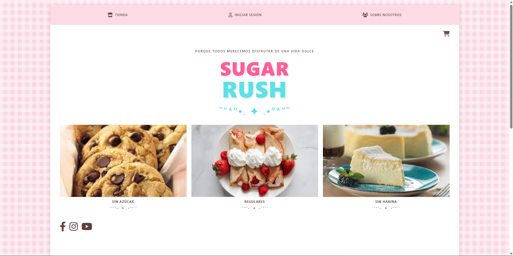
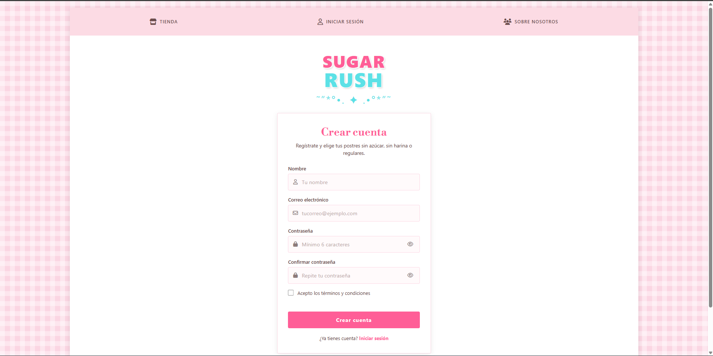

# Sugar Rush 🍬

Prototipo web de una tienda de postres accesibles: **sin azúcar**, **sin harina** y **regulares**. Proyecto académico de la Universidad Libre.

🔗 **Ver la página:** https://alejocgo.github.io/SugaarRush/

> *Porque todos merecemos disfrutar de una vida dulce.*

## Qué incluye

- **Página principal** (`index.html`): carátula con el logo, las tres categorías de postres y la sección "Sobre Nosotros" con quiénes somos y la misión.
- **Registro** (`registro.html`): crea una cuenta con nombre, correo y contraseña.
- **Inicio de sesión** (`login.html`): entra con tu correo y contraseña.
- **Carrito y métodos de pago** (`carrito.html`): el carrito se llena desde la tienda y se guarda en `localStorage`; incluye pago con tarjeta, PSE y contra-entrega.
- **Sesión visible en la barra**: al iniciar sesión, el botón muestra tu nombre y permite salir.

## Capturas

<!-- Sube las imágenes a una carpeta (por ejemplo "capturas/") y ajusta los nombres -->

| Inicio | Iniciar sesión | Crear cuenta | tienda | carrito | sobre nosotros |
|---|---|---|
|  |  |  |  |  |  |

## Estructura del proyecto

```
SugaarRush/
├── index.html      # Página principal
├── login.html      # Iniciar sesión
├── registro.html   # Crear cuenta
├── tienda.html     # Catálogo de productos
├── carrito.html    # Carrito y métodos de pago
├── styles.css      # Estilos generales
├── auth.css        # Estilos de login y registro
├── auth.js         # Lógica de registro, login y sesión
└── imagenes/       # Fotos de los postres
```

## Cómo funciona la autenticación (prototipo)

No hay servidor ni base de datos. Los usuarios y la sesión se guardan en el `localStorage` del navegador.

- Registro: valida nombre, correo, contraseña de mínimo 6 caracteres, coincidencia de contraseñas y términos aceptados. No permite repetir correos.
- Login: compara correo y contraseña con las cuentas guardadas.
- Una cuenta creada en un navegador o dispositivo **no existe** en otro, ni en una ventana de incógnito.

⚠️ **Limitación:** las contraseñas se guardan en texto plano, solo para fines de demostración. En una versión real, la autenticación iría en un backend con contraseñas cifradas (hash) o con un servicio como Firebase Auth.

## Cómo ejecutarlo en local

1. Clona el repositorio:
   ```bash
   git clone https://github.com/AlejoCGo/SugaarRush.git
   ```
2. Abre `index.html` en tu navegador. No necesita instalar nada.

## Tecnologías

- HTML5 y CSS3 (Grid, Flexbox y diseño responsive)
- JavaScript (sin librerías)
- [Font Awesome](https://fontawesome.com/) para los íconos
- Google Fonts (Libre Bodoni)
- GitHub Pages para la publicación

## Próximos pasos

- Carrito conectado a la sesión del usuario
- Catálogo de productos por categoría con filtros
- Backend real con contraseñas cifradas
- Recuperación de contraseña

## Equipo

<!-- Agrega aquí los nombres de los integrantes -->
